# Plant stage previews

Enlarged renders (12x) of every growth-stage texture. Generated by `tools/make_index.py` from `plants/*.yaml`; these are renders of the 16x16 textures, not in-game screenshots.

Contact sheet of everything: [all.png](all.png)

## Chara braunii - Braun's Stonewort

Confidence: **medium**. Implementation type: `aquatic_plant`.

| # | Stage | Image | What it shows |
|---|---|---|---|
| 1 | Oospore |  | Dark brown or black oospore resting on the muddy bottom. |
| 2 | Sprout | 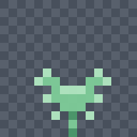 | Short slender green axis with the first small whorl of branchlets. |
| 3 | Growing |  | Taller axis with several whorls of 6-10 straight branchlets, transparent bright green. |
| 4 | Fertile |  | Fully branched with oogonia and antheridia at the nodes, oogonia above antheridia. |

## Datura arenicola - Datura arenicola

Confidence: **low**. Implementation type: `flower_fruit_plant`.

| # | Stage | Image | What it shows |
|---|---|---|---|
| 1 | Seed |  | Small black seed, flat and kidney-shaped, planted in soil. |
| 2 | Seedling |  | Two small green seed leaves on a short stalk. |
| 3 | Vegetative | 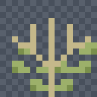 | Leafy plant whose stem forks repeatedly into branches, with a leaf at each fork. |
| 4 | Budding |  | Long tubular buds form at the ends of the branches. |
| 5 | Flowering |  | A single large trumpet-shaped flower opens at the tip of each branch (flower timing and colour in reproduction.flowers). |
| 6 | Fruiting | 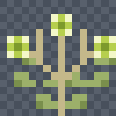 | Petals fall and a green spiny seed capsule swells at the tip of each branch. |
| 7 | Ripe capsule |  | Each capsule browns and splits open, showing black seeds, on the branch tips. |

## Datura ceratocaula - Swamp Datura

Confidence: **medium**. Implementation type: `flower_fruit_plant`.

| # | Stage | Image | What it shows |
|---|---|---|---|
| 1 | Seed |  | Small black seed, flat and kidney-shaped, planted in soil. |
| 2 | Seedling | 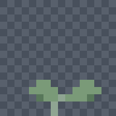 | Two small green seed leaves on a short stalk. |
| 3 | Vegetative |  | Leafy plant whose stem forks repeatedly into branches, with a leaf at each fork. |
| 4 | Budding | 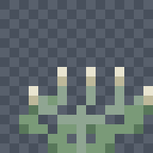 | Long tubular buds form at the ends of the branches. |
| 5 | Flowering | 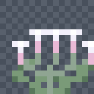 | A single large trumpet-shaped flower opens at the tip of each branch (flower timing and colour in reproduction.flowers). |
| 6 | Fruiting | 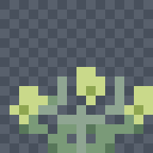 | Petals fall and a green spiny seed capsule swells at the tip of each branch. |
| 7 | Ripe capsule |  | Each capsule browns and splits open, showing black seeds, on the branch tips. |

## Datura discolor - Desert Thorn-Apple

Confidence: **high**. Implementation type: `flower_fruit_plant`.

| # | Stage | Image | What it shows |
|---|---|---|---|
| 1 | Seed |  | Small black seed, flat and kidney-shaped, planted in soil. |
| 2 | Seedling |  | Two small green seed leaves on a short stalk. |
| 3 | Vegetative | 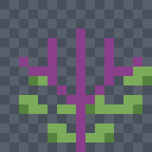 | Leafy plant whose stem forks repeatedly into branches, with a leaf at each fork. |
| 4 | Budding |  | Long tubular buds form at the ends of the branches. |
| 5 | Flowering | 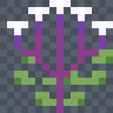 | A single large trumpet-shaped flower opens at the tip of each branch (flower timing and colour in reproduction.flowers). |
| 6 | Fruiting |  | Petals fall and a green spiny seed capsule swells at the tip of each branch. |
| 7 | Ripe capsule |  | Each capsule browns and splits open, showing black seeds, on the branch tips. |

Extra blocks for plants taller than 1 block at the configured scale:

| Role | Image | Note |
|---|---|---|
| lower | 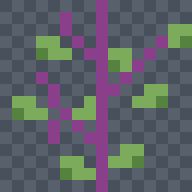 | Leafy stem block placed under the stage texture when this plant grows past 1 block (real height > 1 m). |

Full-height plant (2 blocks): vegetative, budding, flowering, fruiting, ripe capsule, each over the lower block.

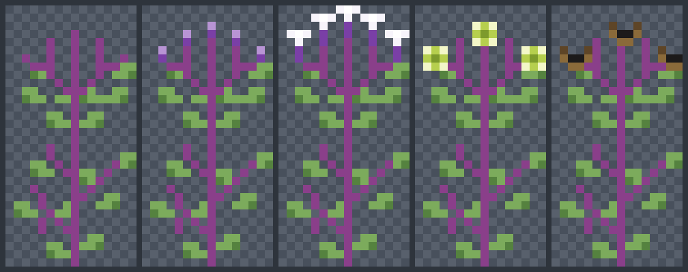

## Datura ferox - Long-Spined Thorn-Apple

Confidence: **medium**. Implementation type: `flower_fruit_plant`.

| # | Stage | Image | What it shows |
|---|---|---|---|
| 1 | Seed |  | Small black seed, flat and kidney-shaped, planted in soil. |
| 2 | Seedling |  | Two small green seed leaves on a short stalk. |
| 3 | Vegetative | 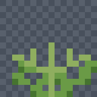 | Leafy plant whose stem forks repeatedly into branches, with a leaf at each fork. |
| 4 | Budding | 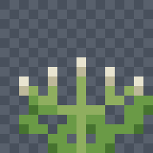 | Long tubular buds form at the ends of the branches. |
| 5 | Flowering |  | A single large trumpet-shaped flower opens at the tip of each branch (flower timing and colour in reproduction.flowers). |
| 6 | Fruiting | 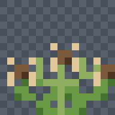 | Petals fall and a green spiny seed capsule swells at the tip of each branch. |
| 7 | Ripe capsule | 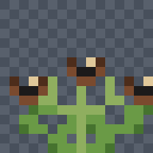 | Each capsule browns and splits open, showing black seeds, on the branch tips. |

## Datura innoxia - Pricklyburr

Confidence: **medium**. Implementation type: `flower_fruit_plant`.

| # | Stage | Image | What it shows |
|---|---|---|---|
| 1 | Seed |  | Small black seed, flat and kidney-shaped, planted in soil. |
| 2 | Seedling |  | Two small green seed leaves on a short stalk. |
| 3 | Vegetative |  | Leafy plant whose stem forks repeatedly into branches, with a leaf at each fork. |
| 4 | Budding | 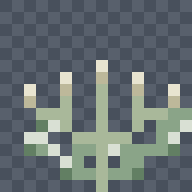 | Long tubular buds form at the ends of the branches. |
| 5 | Flowering |  | A single large trumpet-shaped flower opens at the tip of each branch (flower timing and colour in reproduction.flowers). |
| 6 | Fruiting | 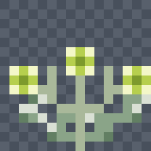 | Petals fall and a green spiny seed capsule swells at the tip of each branch. |
| 7 | Ripe capsule | 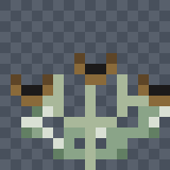 | Each capsule browns and splits open, showing black seeds, on the branch tips. |

Extra blocks for plants taller than 1 block at the configured scale:

| Role | Image | Note |
|---|---|---|
| lower | 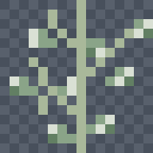 | Leafy stem block placed under the stage texture when this plant grows past 1 block (real height > 1 m). |

Full-height plant (2 blocks): vegetative, budding, flowering, fruiting, ripe capsule, each over the lower block.

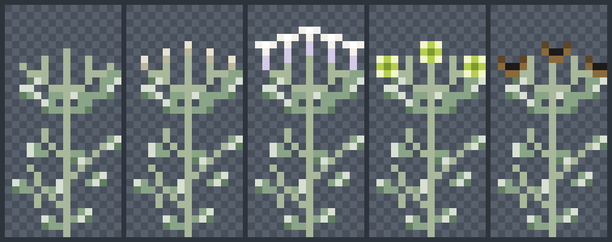

## Datura kymatocarpa - Datura kymatocarpa

Confidence: **low**. Implementation type: `flower_fruit_plant`.

| # | Stage | Image | What it shows |
|---|---|---|---|
| 1 | Seed |  | Small black seed, flat and kidney-shaped, planted in soil. |
| 2 | Seedling | 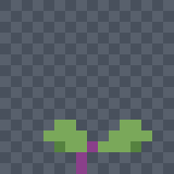 | Two small green seed leaves on a short stalk. |
| 3 | Vegetative |  | Leafy plant whose stem forks repeatedly into branches, with a leaf at each fork. |
| 4 | Budding |  | Long tubular buds form at the ends of the branches. |
| 5 | Flowering |  | A single large trumpet-shaped flower opens at the tip of each branch (flower timing and colour in reproduction.flowers). |
| 6 | Fruiting |  | Petals fall and a green spiny seed capsule swells at the tip of each branch. |
| 7 | Ripe capsule | 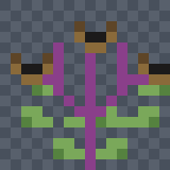 | Each capsule browns and splits open, showing black seeds, on the branch tips. |

## Datura lanosa - Datura lanosa

Confidence: **low**. Implementation type: `flower_fruit_plant`.

| # | Stage | Image | What it shows |
|---|---|---|---|
| 1 | Seed |  | Small black seed, flat and kidney-shaped, planted in soil. |
| 2 | Seedling | 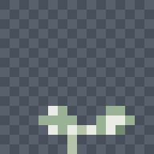 | Two small green seed leaves on a short stalk. |
| 3 | Vegetative |  | Leafy plant whose stem forks repeatedly into branches, with a leaf at each fork. |
| 4 | Budding |  | Long tubular buds form at the ends of the branches. |
| 5 | Flowering |  | A single large trumpet-shaped flower opens at the tip of each branch (flower timing and colour in reproduction.flowers). |
| 6 | Fruiting |  | Petals fall and a green spiny seed capsule swells at the tip of each branch. |
| 7 | Ripe capsule | 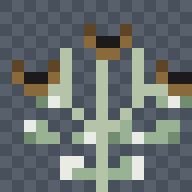 | Each capsule browns and splits open, showing black seeds, on the branch tips. |

## Datura leichhardtii - Leichhardt'S Datura

Confidence: **medium**. Implementation type: `flower_fruit_plant`.

| # | Stage | Image | What it shows |
|---|---|---|---|
| 1 | Seed |  | Small black seed, flat and kidney-shaped, planted in soil. |
| 2 | Seedling | 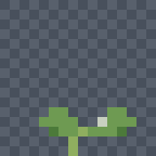 | Two small green seed leaves on a short stalk. |
| 3 | Vegetative | 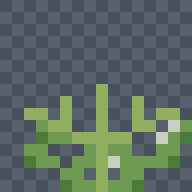 | Leafy plant whose stem forks repeatedly into branches, with a leaf at each fork. |
| 4 | Budding |  | Long tubular buds form at the ends of the branches. |
| 5 | Flowering |  | A single large trumpet-shaped flower opens at the tip of each branch (flower timing and colour in reproduction.flowers). |
| 6 | Fruiting |  | Petals fall and a green spiny seed capsule swells at the tip of each branch. |
| 7 | Ripe capsule |  | Each capsule browns and splits open, showing black seeds, on the branch tips. |

## Datura metel - Devil'S Trumpet

Confidence: **high**. Implementation type: `flower_fruit_plant`.

| # | Stage | Image | What it shows |
|---|---|---|---|
| 1 | Seed |  | Small black seed, flat and kidney-shaped, planted in soil. |
| 2 | Seedling |  | Two small green seed leaves on a short stalk. |
| 3 | Vegetative | 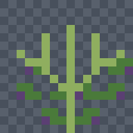 | Leafy plant whose stem forks repeatedly into branches, with a leaf at each fork. |
| 4 | Budding |  | Long tubular buds form at the ends of the branches. |
| 5 | Flowering |  | A single large trumpet-shaped flower opens at the tip of each branch (flower timing and colour in reproduction.flowers). |
| 6 | Fruiting |  | Petals fall and a green spiny seed capsule swells at the tip of each branch. |
| 7 | Ripe capsule |  | Each capsule browns and splits open, showing black seeds, on the branch tips. |

Extra blocks for plants taller than 1 block at the configured scale:

| Role | Image | Note |
|---|---|---|
| lower | 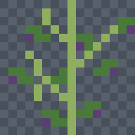 | Leafy stem block placed under the stage texture when this plant grows past 1 block (real height > 1 m). |

Full-height plant (2 blocks): vegetative, budding, flowering, fruiting, ripe capsule, each over the lower block.

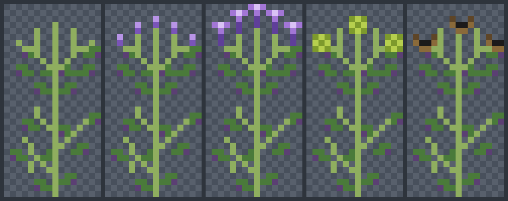

## Datura pruinosa - Pruinose Thorn-Apple

Confidence: **low**. Implementation type: `flower_fruit_plant`.

| # | Stage | Image | What it shows |
|---|---|---|---|
| 1 | Seed |  | Small black seed, flat and kidney-shaped, planted in soil. |
| 2 | Seedling |  | Two small green seed leaves on a short stalk. |
| 3 | Vegetative | 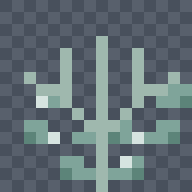 | Leafy plant whose stem forks repeatedly into branches, with a leaf at each fork. |
| 4 | Budding | 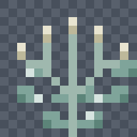 | Long tubular buds form at the ends of the branches. |
| 5 | Flowering |  | A single large trumpet-shaped flower opens at the tip of each branch (flower timing and colour in reproduction.flowers). |
| 6 | Fruiting | 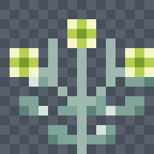 | Petals fall and a green spiny seed capsule swells at the tip of each branch. |
| 7 | Ripe capsule | 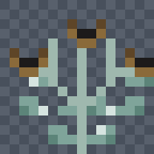 | Each capsule browns and splits open, showing black seeds, on the branch tips. |

## Datura quercifolia - Oak-Leaved Thorn-Apple

Confidence: **medium**. Implementation type: `flower_fruit_plant`.

| # | Stage | Image | What it shows |
|---|---|---|---|
| 1 | Seed |  | Small black seed, flat and kidney-shaped, planted in soil. |
| 2 | Seedling |  | Two small green seed leaves on a short stalk. |
| 3 | Vegetative | 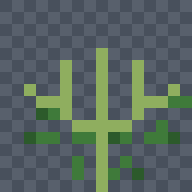 | Leafy plant whose stem forks repeatedly into branches, with a leaf at each fork. |
| 4 | Budding | 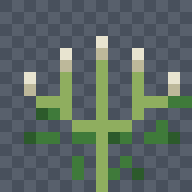 | Long tubular buds form at the ends of the branches. |
| 5 | Flowering |  | A single large trumpet-shaped flower opens at the tip of each branch (flower timing and colour in reproduction.flowers). |
| 6 | Fruiting |  | Petals fall and a green spiny seed capsule swells at the tip of each branch. |
| 7 | Ripe capsule | 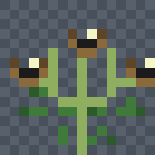 | Each capsule browns and splits open, showing black seeds, on the branch tips. |

## Datura reburra - Datura reburra

Confidence: **low**. Implementation type: `flower_fruit_plant`.

| # | Stage | Image | What it shows |
|---|---|---|---|
| 1 | Seed |  | Small black seed, flat and kidney-shaped, planted in soil. |
| 2 | Seedling | 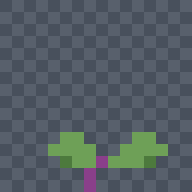 | Two small green seed leaves on a short stalk. |
| 3 | Vegetative |  | Leafy plant whose stem forks repeatedly into branches, with a leaf at each fork. |
| 4 | Budding | 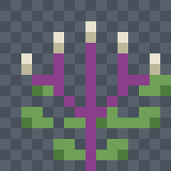 | Long tubular buds form at the ends of the branches. |
| 5 | Flowering |  | A single large trumpet-shaped flower opens at the tip of each branch (flower timing and colour in reproduction.flowers). |
| 6 | Fruiting | 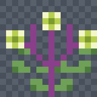 | Petals fall and a green spiny seed capsule swells at the tip of each branch. |
| 7 | Ripe capsule | 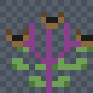 | Each capsule browns and splits open, showing black seeds, on the branch tips. |

## Datura stramonium - Jimsonweed

Confidence: **high**. Implementation type: `flower_fruit_plant`.

| # | Stage | Image | What it shows |
|---|---|---|---|
| 1 | Seed |  | Small black seed, flat and kidney-shaped, planted in soil. |
| 2 | Seedling |  | Two small green seed leaves on a short stalk. |
| 3 | Vegetative |  | Leafy plant whose stem forks repeatedly into branches, with a leaf at each fork. |
| 4 | Budding |  | Long tubular buds form at the ends of the branches. |
| 5 | Flowering | 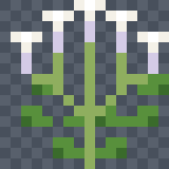 | A single large trumpet-shaped flower opens at the tip of each branch (flower timing and colour in reproduction.flowers). |
| 6 | Fruiting | 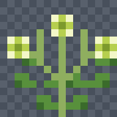 | Petals fall and a green spiny seed capsule swells at the tip of each branch. |
| 7 | Ripe capsule |  | Each capsule browns and splits open, showing black seeds, on the branch tips. |

Extra blocks for plants taller than 1 block at the configured scale:

| Role | Image | Note |
|---|---|---|
| lower | 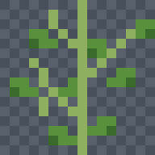 | Leafy stem block placed under the stage texture when this plant grows past 1 block (real height > 1 m). |

Full-height plant (2 blocks): vegetative, budding, flowering, fruiting, ripe capsule, each over the lower block.

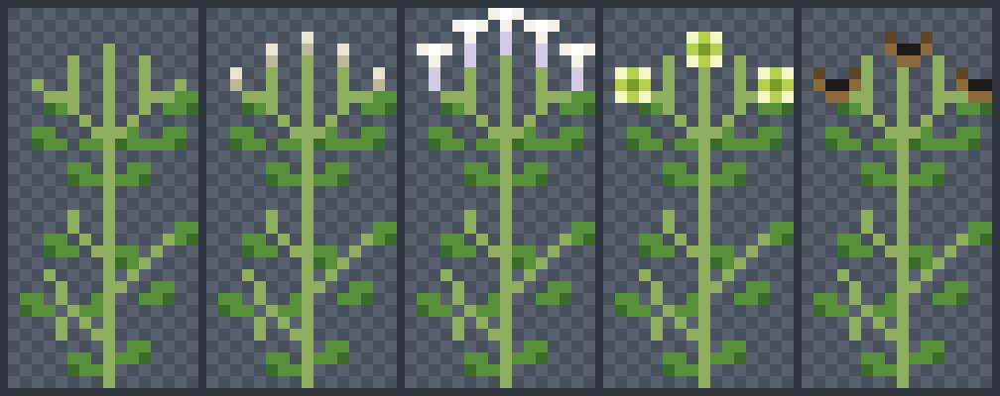

## Datura wrightii - Sacred Thorn-Apple

Confidence: **high**. Implementation type: `flower_fruit_plant`.

| # | Stage | Image | What it shows |
|---|---|---|---|
| 1 | Seed |  | Small black seed, flat and kidney-shaped, planted in soil. |
| 2 | Seedling |  | Two small green seed leaves on a short stalk. |
| 3 | Vegetative | 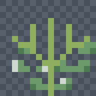 | Leafy plant whose stem forks repeatedly into branches, with a leaf at each fork. |
| 4 | Budding |  | Long tubular buds form at the ends of the branches. |
| 5 | Flowering |  | A single large trumpet-shaped flower opens at the tip of each branch (flower timing and colour in reproduction.flowers). |
| 6 | Fruiting | 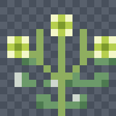 | Petals fall and a green spiny seed capsule swells at the tip of each branch. |
| 7 | Ripe capsule | 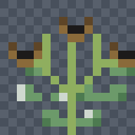 | Each capsule browns and splits open, showing black seeds, on the branch tips. |

Extra blocks for plants taller than 1 block at the configured scale:

| Role | Image | Note |
|---|---|---|
| lower | 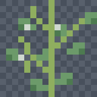 | Leafy stem block placed under the stage texture when this plant grows past 1 block (real height > 1 m). |

Full-height plant (2 blocks): vegetative, budding, flowering, fruiting, ripe capsule, each over the lower block.

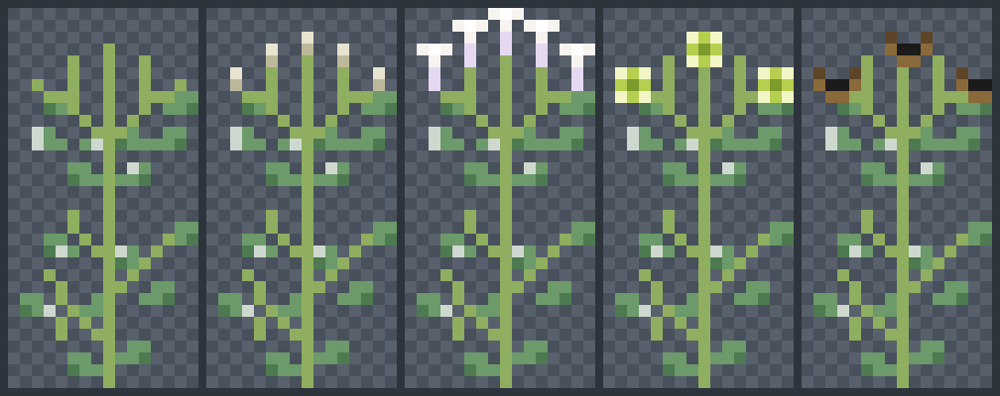

## Eucalyptus deglupta - Rainbow Eucalyptus

Confidence: **high**. Implementation type: `fruit_tree`.

| # | Stage | Image | What it shows |
|---|---|---|---|
| 1 | Seed | 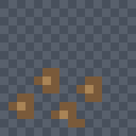 | Minute brown winged seed (3 to 12 per capsule cell). Grown from seed at about 20-22 C. |
| 2 | Sapling |  | Slim young tree: a smooth orange-green stem with pairs of opposite leaves up its length. |
| 3 | Young tree |  | Twigs with paired opposite leaves in lighter green; smooth bark. |
| 4 | Mature tree |  | Twigs bearing opposite pairs of leaves in darker blue-green; the trunk and limbs show shed bark in coloured streaks. |
| 5 | Flowering |  | Cream and pale-yellow flower buds and stamens in clusters at the leaf axils along the branchlets (groups of seven). |
| 6 | Fruiting |  | Small woody brown capsules at the leaf axils along the branchlets. |

Extra blocks for plants taller than 1 block at the configured scale:

| Role | Image | Note |
|---|---|---|
| trunk_side |  | Smooth orange-tinted bark with streaks of pale green, red, orange, grey and purplish brown (Wikipedia). |
| trunk_side_alt |  | Second bark variant so the colours differ along the trunk as strips shed at different times. |
| trunk_top |  | Cut end of the trunk and limbs. |
| branch_side |  | Limb bark: slimmer limbs with smoother, paler streaks. |
| buttress_side |  | Flared base with vertical ridges and grooves (buttresses up to 4 m high, Wikipedia). |

## Ipomoea tricolor - Morning Glory

Confidence: **high**. Implementation type: `climbing_vine`.

| # | Stage | Image | What it shows |
|---|---|---|---|
| 1 | Seed |  | Seed planted next to a block it can climb. |
| 2 | Sprout |  | Small twining shoot with two seed leaves. |
| 3 | Climbing vine |  | Twining stems with heart-shaped leaves covering the support. |
| 4 | Budding |  | Tightly furled twisted buds along the vine. |
| 5 | Flowering |  | Blue trumpet flowers with white centres open. Flower colour shifts red to blue during the bloom ('Heavenly Blue'). |
| 6 | Seed pod |  | Small dry round seed pods replace the spent flowers. |

## Oryza sativa - Rice

Confidence: **high**. Implementation type: `flower_fruit_plant`.

| # | Stage | Image | What it shows |
|---|---|---|---|
| 1 | Grain |  | The grain (caryopsis) inside its husk, planted directly in the field or sown in a seedbed. Grain colours include white, brown, black and red. |
| 2 | Seedling |  | A few thin blades from a small clump with fibrous roots; seedlings are often raised in a seedbed and transplanted. |
| 3 | Tillering |  | The plant makes several leafy upright stems (tillers); each jointed stem has a long slender leaf at every node. |
| 4 | Flowering |  | A branched panicle arises from the last internode of the stem, carrying spikelets whose anthers and ovules are self-fertile. |
| 5 | Ripe |  | Fertilised ovules fill into grain and the panicle bends under its weight; the grain is ready when its moisture is 20-25% and the plant yellows. |

Extra blocks for plants taller than 1 block at the configured scale:

| Role | Image | Note |
|---|---|---|
| lower |  | Lower block of a plant taller than 1 block: upright jointed tillers with leaf blades, matching the top block's stems at the join. |

Full-height plant (2 blocks): vegetative, budding, flowering, fruiting, ripe capsule, each over the lower block.

## Prunus persica - Peach Tree

Confidence: **high**. Implementation type: `fruit_tree`.

| # | Stage | Image | What it shows |
|---|---|---|---|
| 1 | Sapling |  | Thin whip with a few leaves. |
| 2 | Young tree |  | Single trunk with smooth red twigs; alternate lanceolate leaves along each twig. |
| 3 | Budding |  | Bare red twigs with swollen pink-tipped buds; flowers come before the leaves in the real tree. |
| 4 | Blossom |  | Pink flowers (4-5 petals, dark centre) sit directly on the red twigs, with few leaves. |
| 5 | Fruit set |  | Petals fall; small hard green fruits hang from the twigs among alternate leaves. |
| 6 | Unripe fruit |  | Greenish-yellow fruits growing on the twigs. |
| 7 | Ripe fruit |  | Ripe fruits 5-7 cm across, yellow-orange with a red blush, hanging from the twigs. |

Extra blocks for plants taller than 1 block at the configured scale:

| Role | Image | Note |
|---|---|---|
| trunk_side |  | Dark grey bark with horizontal lenticels (Wikipedia). |
| trunk_top |  | Cut end of the trunk. |
| branch_side |  | Limb bark: redder and smoother than the trunk ('the bark is usually red' on twigs, Wikipedia). |

## Salvia rosmarinus - Rosemary

Confidence: **high**. Implementation type: `flower_fruit_plant`.

| # | Stage | Image | What it shows |
|---|---|---|---|
| 1 | Seed |  | Small seed; seeds are often difficult to start and have a low germination rate. |
| 2 | Seedling |  | Tiny shoot with a few short needle leaves. |
| 3 | Young shrub |  | Small shrub: a few woody stems fork from the base, with needle leaves along them. Too young to harvest: the bush should mature 2-3 years first. |
| 4 | Mature shrub |  | Dense evergreen bush of several branching woody stems with needle leaves along each (green above, pale below). Can be harvested (up to 20% of growth). |
| 5 | Flowering |  | Groups of 2 to 3 small flowers down the length of the branches in white, pink, purple or deep blue. |

Extra blocks for plants taller than 1 block at the configured scale:

| Role | Image | Note |
|---|---|---|
| lower |  | Lower block of the 2-block bush: woody stems with needles and side branches, matching the top block's stems at the join. |

Full-height plant (2 blocks): vegetative, budding, flowering, fruiting, ripe capsule, each over the lower block.

