# Plant stage previews

Enlarged renders (12x) of every growth-stage texture. Generated by `tools/make_index.py` from `plants/*.yaml`; these are renders of the 16x16 textures, not in-game screenshots.

Contact sheet of everything: [all.png](all.png)

## Chara braunii - Braun's Stonewort

Confidence: **medium**. Implementation type: `aquatic_plant`.

| # | Stage | Image | What it shows |
|---|---|---|---|
| 1 | Oospore | 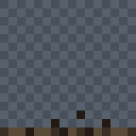 | Dark brown or black oospore resting on the muddy bottom. |
| 2 | Sprout |  | Short slender green axis with the first small whorl of branchlets. |
| 3 | Growing | 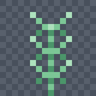 | Taller axis with several whorls of 6-10 straight branchlets, transparent bright green. |
| 4 | Fertile | 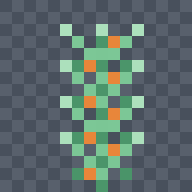 | Fully branched with oogonia and antheridia at the nodes, oogonia above antheridia. |

## Datura arenicola - Datura arenicola

Confidence: **low**. Implementation type: `flower_fruit_plant`.

| # | Stage | Image | What it shows |
|---|---|---|---|
| 1 | Seed |  | Small black seed, flat and kidney-shaped, planted in soil. |
| 2 | Seedling | 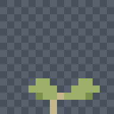 | Two small green seed leaves on a short stalk. |
| 3 | Vegetative |  | Leafy branched herb or shrub with broad, toothed or wavy leaves. |
| 4 | Budding | 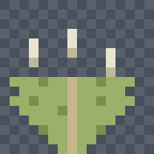 | Long tubular buds appear in leaf axils and branch forks, twisted and furled. |
| 5 | Flowering | 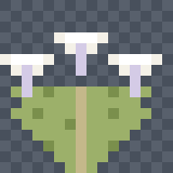 | Large trumpet-shaped flowers open (see flower notes for timing and colour). |
| 6 | Fruiting |  | Petals fall and a green spiny seed capsule swells. |
| 7 | Ripe capsule | 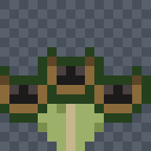 | Capsule browns and splits open, showing black seeds. |

## Datura ceratocaula - Swamp Datura

Confidence: **medium**. Implementation type: `flower_fruit_plant`.

| # | Stage | Image | What it shows |
|---|---|---|---|
| 1 | Seed |  | Small black seed, flat and kidney-shaped, planted in soil. |
| 2 | Seedling |  | Two small green seed leaves on a short stalk. |
| 3 | Vegetative | 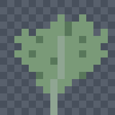 | Leafy branched herb or shrub with broad, toothed or wavy leaves. |
| 4 | Budding |  | Long tubular buds appear in leaf axils and branch forks, twisted and furled. |
| 5 | Flowering |  | Large trumpet-shaped flowers open (see flower notes for timing and colour). |
| 6 | Fruiting |  | Petals fall and a green spiny seed capsule swells. |
| 7 | Ripe capsule | 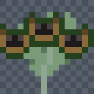 | Capsule browns and splits open, showing black seeds. |

## Datura discolor - Desert Thorn-Apple

Confidence: **high**. Implementation type: `flower_fruit_plant`.

| # | Stage | Image | What it shows |
|---|---|---|---|
| 1 | Seed |  | Small black seed, flat and kidney-shaped, planted in soil. |
| 2 | Seedling |  | Two small green seed leaves on a short stalk. |
| 3 | Vegetative |  | Leafy branched herb or shrub with broad, toothed or wavy leaves. |
| 4 | Budding | 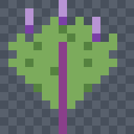 | Long tubular buds appear in leaf axils and branch forks, twisted and furled. |
| 5 | Flowering |  | Large trumpet-shaped flowers open (see flower notes for timing and colour). |
| 6 | Fruiting | 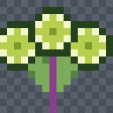 | Petals fall and a green spiny seed capsule swells. |
| 7 | Ripe capsule |  | Capsule browns and splits open, showing black seeds. |

## Datura ferox - Long-Spined Thorn-Apple

Confidence: **medium**. Implementation type: `flower_fruit_plant`.

| # | Stage | Image | What it shows |
|---|---|---|---|
| 1 | Seed |  | Small black seed, flat and kidney-shaped, planted in soil. |
| 2 | Seedling | 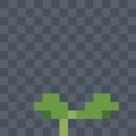 | Two small green seed leaves on a short stalk. |
| 3 | Vegetative |  | Leafy branched herb or shrub with broad, toothed or wavy leaves. |
| 4 | Budding |  | Long tubular buds appear in leaf axils and branch forks, twisted and furled. |
| 5 | Flowering | 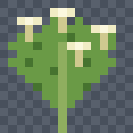 | Large trumpet-shaped flowers open (see flower notes for timing and colour). |
| 6 | Fruiting |  | Petals fall and a green spiny seed capsule swells. |
| 7 | Ripe capsule |  | Capsule browns and splits open, showing black seeds. |

## Datura innoxia - Pricklyburr

Confidence: **medium**. Implementation type: `flower_fruit_plant`.

| # | Stage | Image | What it shows |
|---|---|---|---|
| 1 | Seed | 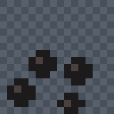 | Small black seed, flat and kidney-shaped, planted in soil. |
| 2 | Seedling |  | Two small green seed leaves on a short stalk. |
| 3 | Vegetative | 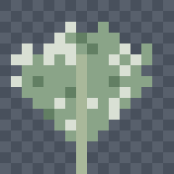 | Leafy branched herb or shrub with broad, toothed or wavy leaves. |
| 4 | Budding |  | Long tubular buds appear in leaf axils and branch forks, twisted and furled. |
| 5 | Flowering | 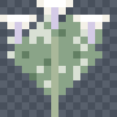 | Large trumpet-shaped flowers open (see flower notes for timing and colour). |
| 6 | Fruiting |  | Petals fall and a green spiny seed capsule swells. |
| 7 | Ripe capsule |  | Capsule browns and splits open, showing black seeds. |

## Datura kymatocarpa - Datura kymatocarpa

Confidence: **low**. Implementation type: `flower_fruit_plant`.

| # | Stage | Image | What it shows |
|---|---|---|---|
| 1 | Seed |  | Small black seed, flat and kidney-shaped, planted in soil. |
| 2 | Seedling |  | Two small green seed leaves on a short stalk. |
| 3 | Vegetative | 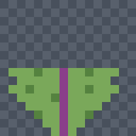 | Leafy branched herb or shrub with broad, toothed or wavy leaves. |
| 4 | Budding | 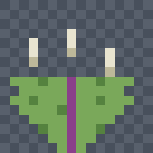 | Long tubular buds appear in leaf axils and branch forks, twisted and furled. |
| 5 | Flowering | 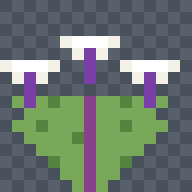 | Large trumpet-shaped flowers open (see flower notes for timing and colour). |
| 6 | Fruiting | 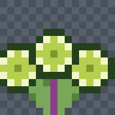 | Petals fall and a green spiny seed capsule swells. |
| 7 | Ripe capsule |  | Capsule browns and splits open, showing black seeds. |

## Datura lanosa - Datura lanosa

Confidence: **low**. Implementation type: `flower_fruit_plant`.

| # | Stage | Image | What it shows |
|---|---|---|---|
| 1 | Seed |  | Small black seed, flat and kidney-shaped, planted in soil. |
| 2 | Seedling |  | Two small green seed leaves on a short stalk. |
| 3 | Vegetative | 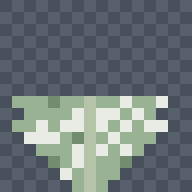 | Leafy branched herb or shrub with broad, toothed or wavy leaves. |
| 4 | Budding | 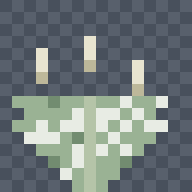 | Long tubular buds appear in leaf axils and branch forks, twisted and furled. |
| 5 | Flowering | 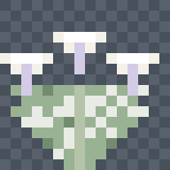 | Large trumpet-shaped flowers open (see flower notes for timing and colour). |
| 6 | Fruiting | 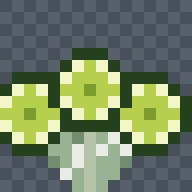 | Petals fall and a green spiny seed capsule swells. |
| 7 | Ripe capsule |  | Capsule browns and splits open, showing black seeds. |

## Datura leichhardtii - Leichhardt'S Datura

Confidence: **medium**. Implementation type: `flower_fruit_plant`.

| # | Stage | Image | What it shows |
|---|---|---|---|
| 1 | Seed |  | Small black seed, flat and kidney-shaped, planted in soil. |
| 2 | Seedling |  | Two small green seed leaves on a short stalk. |
| 3 | Vegetative |  | Leafy branched herb or shrub with broad, toothed or wavy leaves. |
| 4 | Budding | 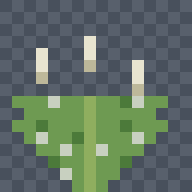 | Long tubular buds appear in leaf axils and branch forks, twisted and furled. |
| 5 | Flowering | 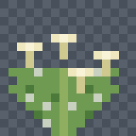 | Large trumpet-shaped flowers open (see flower notes for timing and colour). |
| 6 | Fruiting | 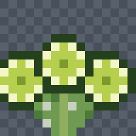 | Petals fall and a green spiny seed capsule swells. |
| 7 | Ripe capsule | 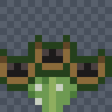 | Capsule browns and splits open, showing black seeds. |

## Datura metel - Devil'S Trumpet

Confidence: **high**. Implementation type: `flower_fruit_plant`.

| # | Stage | Image | What it shows |
|---|---|---|---|
| 1 | Seed |  | Small black seed, flat and kidney-shaped, planted in soil. |
| 2 | Seedling | 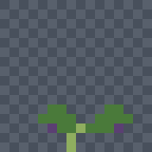 | Two small green seed leaves on a short stalk. |
| 3 | Vegetative |  | Leafy branched herb or shrub with broad, toothed or wavy leaves. |
| 4 | Budding | 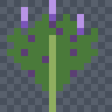 | Long tubular buds appear in leaf axils and branch forks, twisted and furled. |
| 5 | Flowering | 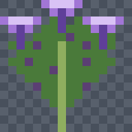 | Large trumpet-shaped flowers open (see flower notes for timing and colour). |
| 6 | Fruiting | 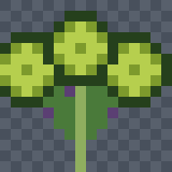 | Petals fall and a green spiny seed capsule swells. |
| 7 | Ripe capsule | 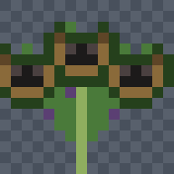 | Capsule browns and splits open, showing black seeds. |

## Datura pruinosa - Pruinose Thorn-Apple

Confidence: **low**. Implementation type: `flower_fruit_plant`.

| # | Stage | Image | What it shows |
|---|---|---|---|
| 1 | Seed |  | Small black seed, flat and kidney-shaped, planted in soil. |
| 2 | Seedling | 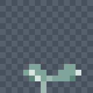 | Two small green seed leaves on a short stalk. |
| 3 | Vegetative |  | Leafy branched herb or shrub with broad, toothed or wavy leaves. |
| 4 | Budding |  | Long tubular buds appear in leaf axils and branch forks, twisted and furled. |
| 5 | Flowering | 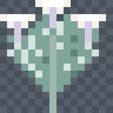 | Large trumpet-shaped flowers open (see flower notes for timing and colour). |
| 6 | Fruiting |  | Petals fall and a green spiny seed capsule swells. |
| 7 | Ripe capsule |  | Capsule browns and splits open, showing black seeds. |

## Datura quercifolia - Oak-Leaved Thorn-Apple

Confidence: **medium**. Implementation type: `flower_fruit_plant`.

| # | Stage | Image | What it shows |
|---|---|---|---|
| 1 | Seed |  | Small black seed, flat and kidney-shaped, planted in soil. |
| 2 | Seedling | 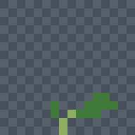 | Two small green seed leaves on a short stalk. |
| 3 | Vegetative |  | Leafy branched herb or shrub with broad, toothed or wavy leaves. |
| 4 | Budding |  | Long tubular buds appear in leaf axils and branch forks, twisted and furled. |
| 5 | Flowering | 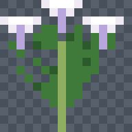 | Large trumpet-shaped flowers open (see flower notes for timing and colour). |
| 6 | Fruiting | 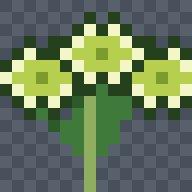 | Petals fall and a green spiny seed capsule swells. |
| 7 | Ripe capsule |  | Capsule browns and splits open, showing black seeds. |

## Datura reburra - Datura reburra

Confidence: **low**. Implementation type: `flower_fruit_plant`.

| # | Stage | Image | What it shows |
|---|---|---|---|
| 1 | Seed |  | Small black seed, flat and kidney-shaped, planted in soil. |
| 2 | Seedling |  | Two small green seed leaves on a short stalk. |
| 3 | Vegetative |  | Leafy branched herb or shrub with broad, toothed or wavy leaves. |
| 4 | Budding |  | Long tubular buds appear in leaf axils and branch forks, twisted and furled. |
| 5 | Flowering | 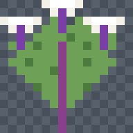 | Large trumpet-shaped flowers open (see flower notes for timing and colour). |
| 6 | Fruiting |  | Petals fall and a green spiny seed capsule swells. |
| 7 | Ripe capsule |  | Capsule browns and splits open, showing black seeds. |

## Datura stramonium - Jimsonweed

Confidence: **high**. Implementation type: `flower_fruit_plant`.

| # | Stage | Image | What it shows |
|---|---|---|---|
| 1 | Seed |  | Small black seed, flat and kidney-shaped, planted in soil. |
| 2 | Seedling | 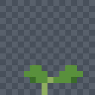 | Two small green seed leaves on a short stalk. |
| 3 | Vegetative | 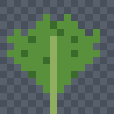 | Leafy branched herb or shrub with broad, toothed or wavy leaves. |
| 4 | Budding | 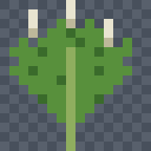 | Long tubular buds appear in leaf axils and branch forks, twisted and furled. |
| 5 | Flowering |  | Large trumpet-shaped flowers open (see flower notes for timing and colour). |
| 6 | Fruiting |  | Petals fall and a green spiny seed capsule swells. |
| 7 | Ripe capsule | 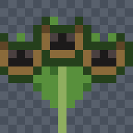 | Capsule browns and splits open, showing black seeds. |

## Datura wrightii - Sacred Thorn-Apple

Confidence: **high**. Implementation type: `flower_fruit_plant`.

| # | Stage | Image | What it shows |
|---|---|---|---|
| 1 | Seed |  | Small black seed, flat and kidney-shaped, planted in soil. |
| 2 | Seedling | 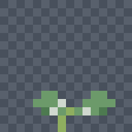 | Two small green seed leaves on a short stalk. |
| 3 | Vegetative |  | Leafy branched herb or shrub with broad, toothed or wavy leaves. |
| 4 | Budding | 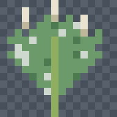 | Long tubular buds appear in leaf axils and branch forks, twisted and furled. |
| 5 | Flowering | 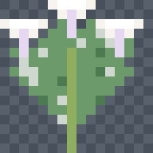 | Large trumpet-shaped flowers open (see flower notes for timing and colour). |
| 6 | Fruiting |  | Petals fall and a green spiny seed capsule swells. |
| 7 | Ripe capsule |  | Capsule browns and splits open, showing black seeds. |

## Ipomoea tricolor - Morning Glory

Confidence: **high**. Implementation type: `climbing_vine`.

| # | Stage | Image | What it shows |
|---|---|---|---|
| 1 | Seed | 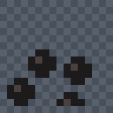 | Seed planted next to a block it can climb. |
| 2 | Sprout |  | Small twining shoot with two seed leaves. |
| 3 | Climbing vine |  | Twining stems with heart-shaped leaves covering the support. |
| 4 | Budding |  | Tightly furled twisted buds along the vine. |
| 5 | Flowering |  | Blue trumpet flowers with white centres open. Flower colour shifts red to blue during the bloom ('Heavenly Blue'). |
| 6 | Seed pod | 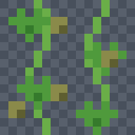 | Small dry round seed pods replace the spent flowers. |

## Prunus persica - Peach Tree

Confidence: **high**. Implementation type: `fruit_tree`.

| # | Stage | Image | What it shows |
|---|---|---|---|
| 1 | Sapling |  | Thin whip with a few leaves. |
| 2 | Young tree | 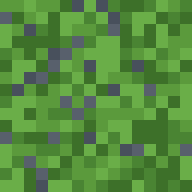 | Single trunk with green leaves; too young to flower (real trees fruit 2-3 years after sprouting). |
| 3 | Budding | 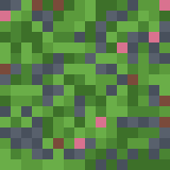 | Bare-looking twigs with swollen buds; flowers appear before leaves in the real tree. |
| 4 | Blossom |  | Pink flowers cover the branches (single, 2-3.5 cm, four or five cup-shaped petals; dark purple-red anthers). |
| 5 | Fruit set |  | Petals fall, small hard green fruit forms among the leaves. |
| 6 | Unripe fruit |  | Greenish-white to yellow-green fruit, growing. |
| 7 | Ripe fruit |  | Fruit 5-7 cm across, yellow-orange with a red blush on the sunny side, with a seam on one side. |
